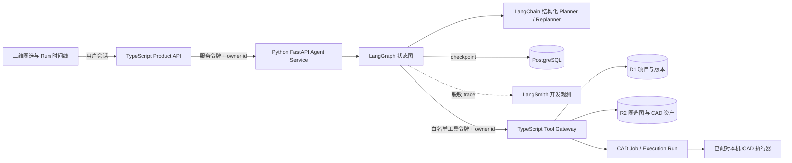
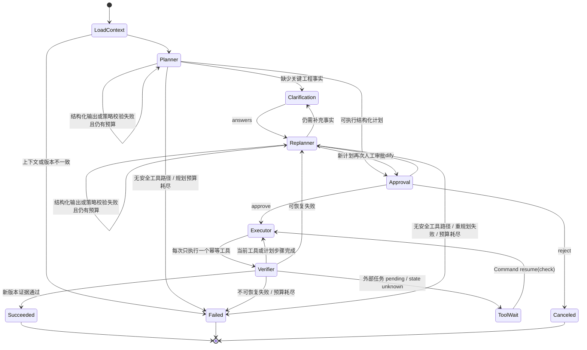

# Agent 返工闭环架构

本文只描述当前工程实现与可靠性边界，不是比赛讲解或简历包装材料。

## 组件边界

- Python Agent 不连接 D1、R2 或本机执行器，只持有 LangGraph checkpoint。
- TypeScript Tool Gateway 不接收模型自由生成的 URL 或 SQL，只接收固定 schema 的六种工具。
- 浏览器不持有两个服务间的令牌；用户身份由产品 API 解析后沿受信任请求传递。
- `run_id` 与 `thread_id` 由 `owner_id + client_request_id` 确定性生成，同一请求恢复同一状态图线程。

## 观测与状态真相源

- PostgreSQL Checkpointer 是执行、interrupt/resume 和崩溃恢复的唯一真相源；LangSmith 不参与状态判定。
- LangSmith 默认关闭，只在 Agent 服务端配置 API Key 后启用。每次图启动或恢复形成一条根 trace，共享 `repair_run_id` 与 `thread_id` 关联同一持久 Run。
- 输入、输出与 metadata 在客户端移除 owner id、图片 data URL、密钥字段和可识别的 provider credential 后才上传。传输或刷新失败不改变 Agent 结果。
- 产品 Run 时间线仍是用户视图；LangSmith 用于开发者检查节点、模型、工具、延迟、token 与异常。
- 当前集成覆盖 LangSmith trace 树。Studio Graph Mode 需要后续添加仅供开发的 Agent Server 适配层，且必须复用同一 `build_repair_graph()`，不重写业务图。

## LangGraph 状态图

`Clarification`、`Approval` 和 `ToolWait` 使用 LangGraph interrupt。澄清回答只进入 Replanner，不能直接触发工具；新计划仍须独立审批。恢复必须使用原 `thread_id`；节点可能从头重新执行，因此审批位于副作用之前，工具调用使用稳定幂等键。每次图调用使用同步持久化语义，API 的 Run View 从 checkpoint 派生，不维护第二份容易漂移的运行表。

## 受控 CAD 工具序列

| 顺序 | 工具 | 副作用或证据 | 幂等依据 |
| --- | --- | --- | --- |
| 1 | `apply_design_change` | 修改白名单 CAD 参数，创建 Revision | Revision 中的 run/tool marker |
| 2 | `create_cad_job` | 固化设计 JSON 与 SHA-256 | 幂等键派生 CAD Job UUID |
| 3 | `start_cad_execution` | 选择已授权执行器并排队 | 幂等键派生 Run UUID + Job 唯一约束 |
| 4 | `poll_cad_execution` | 只读 queued/leased/succeeded/failure | Execution Run 状态 |
| 5 | `attach_cad_result` | 用签名归档结果替换该设计的派生零件，创建 Revision | Revision marker + Job attached 状态 |
| 6 | `verify_revision` | 校验 Revision、设计 hash、资产来源、接口量规、交叠记录与执行签名 | 只读证据聚合 |

Planner 只选择高层动作 `change_cad_parameters`、`create_cad_design` 或 `needs_engineering_review`；低层工具顺序由代码固定，模型不能跳过附加或验证步骤。

Planner/Replanner 的模型响应必须带 provider usage metadata。结构化输出解析或计划策略校验失败时，两者都在当前规划轮次内按预算重试；失败调用已经产生的 token/成本同样记账，不能借重试绕过总预算。输入/输出 token、按显式费率估算的美元成本与工具/重规划计数都进入 checkpoint；token、成本、单次输出、工具次数、每轮计划尝试次数、重规划次数、模型/Gateway 超时和 Run 存续时间由代码独立限制，不能由模型扩大。

## 状态与错误语义

- `retryable`：可进入 Replanner，但仍受重规划和工具次数预算限制。
- `non_retryable`：立即失败，不能通过改提示词绕过工程约束。
- `state_unknown`：进入 ToolWait，以同一幂等键查询，禁止盲目创建第二个任务。
- `human_required`：若缺少可由用户补充的事实，先进入澄清和重规划；事实充分后仍无安全工具路径则明确终止为人工工程处理。

终态 `succeeded` 只表示软件链路完成：新 Revision、CAD 资产、数字证据和已登记执行器签名一致。它不表示物理验证、独立 CAD 重算或生产放行。

## 自动化证据

- Python 图测试覆盖 Planner/Replanner 有预算结构化输出重试、澄清后重规划、批准前零副作用、批准、拒绝、修改后重规划、人工升级、工具失败后重规划、等待恢复、预算耗尽和重新编译图后的 checkpoint 恢复。
- 共享 JSON fixture 同时由 TypeScript Zod 与 Python Pydantic 校验，防止跨语言契约漂移。
- Miniflare Golden 测试使用真实 D1/R2 binding 跑通六工具链，并验证副作用重放后仍只有一个 CAD Job、一个 Execution Run 和预期 Revision 数。
- PostgreSQL 集成测试使用官方 Postgres checkpointer 和一次性数据库容器；需要 Docker Desktop 守护进程可用。
- LangSmith 观测测试覆盖客户端脱敏、Run/thread metadata 关联、关闭时零网络依赖，并用真实 LangGraph 微型图验证根 span 与节点子 span 的父子结构。
